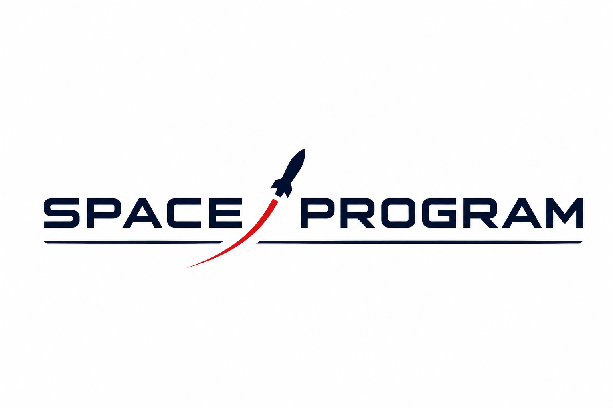
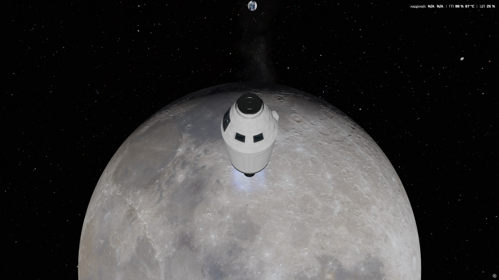
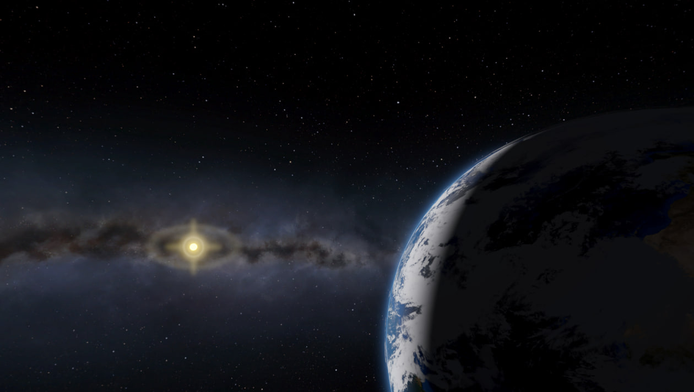
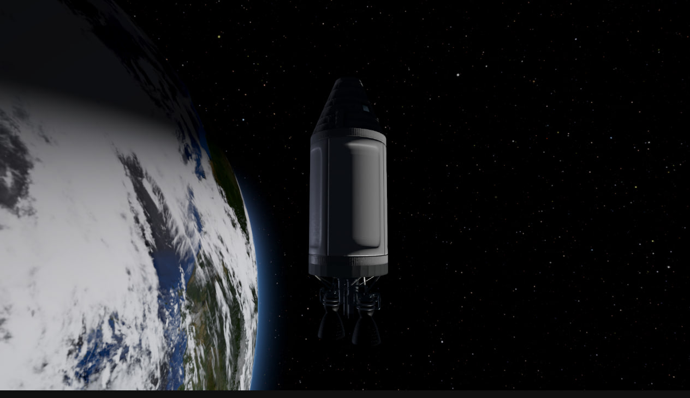

# Space Program

Хардкорный, детерминированный симулятор космических полетов и песочница (в духе KSP), созданный на Unity и C#. 

Проект сфокусирован на математически точной орбитальной механике, четком разделении логики симуляции и визуализации, а также на полностью детерминированном физическом ядре.

## Скриншоты

## Ключевые особенности

*   **Детерминированное физическое ядро:** Собственный движок на чистом C#, полностью независимый от Unity. Использует точность `double`, фиксированный шаг времени и интегратор Velocity Verlet.
*   **Реалистичная орбитальная механика:** Patched conics, сферы влияния (SoI), Kepler rails и аналитические орбитальные переходы.
*   **Lockstep мультиплеер:** Синхронизация по UDP на 50 Гц с проверкой контрольных сумм (checksum), обработкой рассинхрона (sync-on-drift) и детерминированными ID сущностей.
*   **Процедурный LOD-террейн:** Генерация планет на базе cube-sphere с квадродеревом, интеграция реальных карт высот (GEBCO/LDEM), Floating Origin и бесшовные стыки LOD.
*   **3D-редактор сборки (VAB):** Блочная сборка ракет с математикой стыковки узлов, радиальной симметрией и динамическим расчетом центра масс (CoM).
*   **Продвинутые ступени:** Твердотопливные ускорители, радиальные разделители и логика многоступенчатого сброса.

## Архитектура («Мозг и Глаза»)

Проект строго разделен на два слоя:
1.  **SimulationCore (Мозг):** Чистый C#. Отвечает за всю физику, орбитальную математику, состояние мира, сеть и сохранения (`WorldSnapshot`). Имеет **нулевые** зависимости от `UnityEngine`.
2.  **UnityAdapter (Глаза):** Отвечает за рендеринг, ввод, камеру, HUD и интерфейс VAB. Только читает состояние из Ядра и визуализирует его.

## Важно: Тяжелые ассеты не включены

В этом репозитории находится **только исходный код и документация**. 

Чтобы репозиторий оставался легким, тяжелые датасеты не отслеживаются Git:
*   Карты высот (`.raw`, `.dds`)
*   Текстуры высокого разрешения (`.png`)
*   Аудиофайлы и собранные билды (`.exe`, `.app`)

*Если вы клонируете репозиторий, планеты не будут отображаться корректно, пока вы не добавите свои собственные данные высот и текстуры в папку `StreamingAssets`.*

## Стек технологий и разработка

*   **Движок:** Unity 6 (URP)
*   **Язык:** C#
*   **AI-ассистированная разработка (AI-Assisted Development):** Этот проект создается с использованием современных AI-инструментов (Cline, Cursor, LLM). Разработчик выступает в роли системного архитектора: декомпозирует фичи, проектирует базовую архитектуру, пишет спецификации и проводит интеграционное тестирование, в то время как нейросеть генерирует основной код и рутину.

## Текущий статус

*   [x] Детерминированное ядро и орбитальная физика
*   [x] Редактор сборки (VAB)
*   [ ] Lockstep мультиплеер MVP
*   [ ] Атмосфера, аэродинамика и гиперзвук (В процессе)
*   [ ] Наука, экономика и прогрессия (В планах)

---
---

# Space Program (English)

A hardcore, deterministic space flight simulator and sandbox (KSP-like) built with Unity and C#. 

This project focuses on mathematically accurate orbital mechanics, a clean separation between simulation logic and visualization, and a fully deterministic physics core.

## 📸 Screenshots

## Key Features

*   **Deterministic Physics Core:** A custom, pure C# physics engine completely independent of Unity. Uses `double` precision, fixed timestep, and Velocity Verlet integration.
*   **Realistic Orbital Mechanics:** Patched conics, Spheres of Influence (SoI), Kepler rails, and analytical orbital transfers.
*   **Lockstep Multiplayer:** UDP-based network synchronization at 50 Hz with checksum verification, sync-on-drift, and deterministic entity IDs.
*   **Procedural Planet LOD:** Cube-sphere quadtree terrain with real-world elevation data integration (GEBCO/LDEM), floating origin, and seamless LOD stitching.
*   **3D Vehicle Assembly (VAB):** Block-based rocket building with node-snapping, radial symmetry, and dynamic Center of Mass (CoM) calculation.
*   **Advanced Staging:** Solid boosters, radial decouplers, and multi-stage jettison logic.

## Architecture (The "Brain vs Eyes" Approach)

The project is strictly divided into two layers:
1.  **SimulationCore (The Brain):** Pure C#. Handles all physics, orbital math, world state, networking, and save/load (`WorldSnapshot`). It has **zero** dependencies on `UnityEngine`.
2.  **UnityAdapter (The Eyes):** Handles rendering, input, camera, HUD, and the VAB interface. It only reads the state from the Core and visualizes it.

## Important: Heavy Assets Not Included

This repository contains **only the source code and documentation**. 

To keep the repository lightweight, heavy datasets are not tracked by Git:
*   Elevation maps (`.raw`, `.dds`)
*   High-res textures (`.png`)
*   Audio files and Builds (`.exe`, `.app`)

*If you clone this repository, the planets will not render correctly until you provide your own elevation and texture data in the `StreamingAssets` folder.*

## Tech Stack & Development

*   **Engine:** Unity 6 (URP)
*   **Language:** C#
*   **AI-Assisted Development:** This project is built using modern AI-assisted engineering (Cline, Cursor, LLMs). The developer acts as the System Architect, decomposing features, designing the core architecture, writing specifications, and conducting integration testing, while AI generates the boilerplate and implementation code.

## Current Status

*   [x] Deterministic Core & Orbital Physics
*   [x] Vehicle Assembly Building (VAB)
*   [ ] Lockstep Multiplayer MVP
*   [ ] Atmosphere, Aerodynamics & Hypersonic Physics (In Progress)
*   [ ] Science, Economy & Progression (Planned)
